# Afterglow Screensavers

<p align="center"></p>

<p align="center">
  
  
</p>

Four screensavers and a collection in the Afterglow colours, for the Afterglow-themed ReactOS and any Windows that runs `.scr` files.

| Saver | What you see |
| --- | --- |
| **Afterglow Ink** | Marbled ink folding on dark water, now and then rising into aurora curtains |
| **Afterglow Twilight** | A tiny painted planet turning in a glowing atmosphere, with moons and satellites |
| **Afterglow Cracktro** | A demoscene intro: copper bars, plasma, a rotozoomer, a tunnel and a sine scroller |
| **Afterglow Maze** | A walk through dusk architecture with polished floors and glowing sun windows |
| **Afterglow Collection** | All four in turn, with cross-fades |

There is also a fifth, for Quill users to find: **Quill Ghostwriter**, a document that writes itself. It ships with Quill, not here.

Every saver plays a quiet generated soundtrack while it runs (untick "Play sound" in its settings to keep it silent; the preview in Display Properties is always silent). Every saver is drawn by a software renderer on the CPU (no OpenGL), in a tiny `no_std` Rust program with no C runtime that runs on a Pentium. Each has a quality ladder, from a quarter-resolution render for a Pentium III to full resolution with every effect on a modern machine, and the same finishing: glow, light streaks, vignette, film grain, optional letterbox.

> **Status:** experimental, local only, no releases. All four scenes, the Collection and Quill Ghostwriter render on the host and are tested; the Windows `.scr` programs are being built, then run in the ReactOS guest.

## Install

Copy the `.scr` files into `C:\ReactOS\system32` (or `C:\Windows\System32`), then pick one under **Display Properties > Screen Saver**, where **Settings** opens its options.

## Build and look

With Rust 1.98.0 (`rust-toolchain.toml` pins it):

```sh
make check                                                         # the gate
cargo run -p savers-preview --release -- frames --scene ink --to 20 --out previews/ink
cargo run -p savers-preview --release -- bench --scene ink --size 800x600
```

## Learn more

- [SPEC.md](SPEC.md): what each saver does, its settings and registry values
- [docs/scenes.md](docs/scenes.md): the storyboard
- [docs/art.md](docs/art.md): the look and the palettes
- [docs/reactos-scr.md](docs/reactos-scr.md): how ReactOS runs a screensaver
- [docs/decisions.md](docs/decisions.md): why things are the way they are
- [docs/testing.md](docs/testing.md): the gate, the preview tool and the guests

## Licence

Dual-licensed under [Apache-2.0](LICENSE-APACHE) or [MIT](LICENSE-MIT), at your option.
